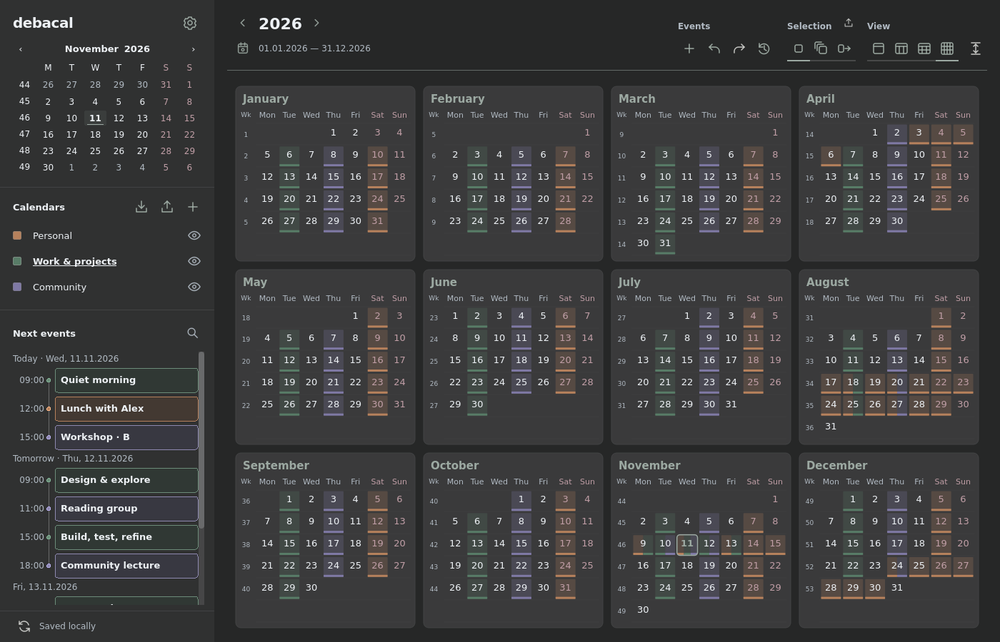
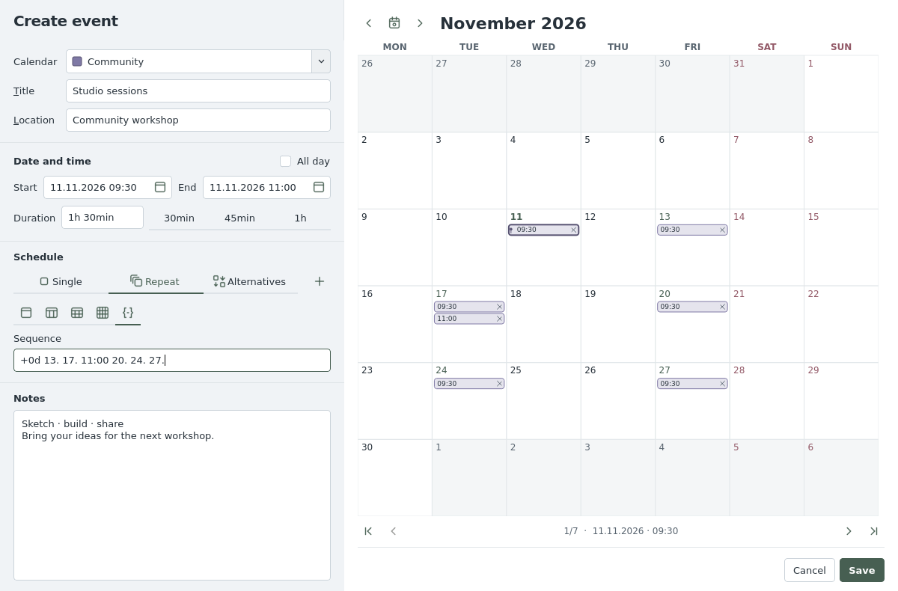

# debacal

By their very nature, calendar apps are a catastrophe, unless you don't really have to use them. So this one is definitely also bad, but maybe slightly less bad than others I have used so far.

The app is completely LLM-coded. I have not looked at a single line of code, but I did put a bit of effort into convincing the agent to make it a bearable user experience. So if you see anything you like, I'll happily take the fame for thinking it up. If there are any issues, you should probably blame the LLM agent ;-).

Below you'll find whatever the agent thought you should know.


A native Linux desktop calendar built with Python and Qt. Your calendar stays usable offline; syncing happens in the background.

## What it does

- **Day, week, month, and year views**, with search, keyboard navigation, and configurable light/dark themes.
- **Nextcloud and other CalDAV calendars**, including discovery, server colors, saved credentials, and visual sync-conflict resolution. CalDAV sync uses vdirsyncer.
- **Standard recurring events and irregular series.** Click dates in the preview or write a compact sequence. Edit one occurrence, the whole series, or this and following occurrences.
- **Alternative time slots:** propose several dates, confirm one, and remove the other choices in one undoable action.
- **ICS import/export**, with an import preview and selectable occurrences. Copy/paste, Ctrl+drag copies, and undo/redo work across calendars and series.

<details>
<summary>More screenshots</summary>





All screenshots use fictional demo events.

</details>

## Install

Requires a Linux desktop and Python 3.11 or newer.

### Arch Linux

```sh
git clone https://github.com/thobl/debacal.git
cd debacal/packaging/arch
makepkg -p PKGBUILD.local -si
```

This builds the checkout and installs the app, its dependencies, and a desktop launcher. To build the published release, use plain `makepkg -si` or the standalone Arch build bundle on the [releases page](https://github.com/thobl/debacal/releases).

To update a checkout, quit Debacal, run `git pull --ff-only` in the repository, then `makepkg -p PKGBUILD.local -sif` in `packaging/arch`. For a published release, use its updated recipe and plain `makepkg -sif`. Restart Debacal afterwards; profiles and settings are retained.

### Other Linux distributions

Install [pipx](https://pipx.pypa.io/stable/installation/), then:

```sh
pipx install https://github.com/thobl/debacal/releases/download/v0.1.3/debacal-0.1.3-py3-none-any.whl
debacal
```

The release also includes a source archive. See [installation details](docs/INSTALL.md) for source installs and desktop integration.

## Getting started

```sh
debacal --demo             # Try fictional events without touching your calendars
debacal                    # Start with a local calendar
debacal appointment.ics    # Preview and import a calendar file
debacal < appointment.ics # Import from standard input
```

Use **+** beside Calendars to connect an account. Select a calendar's name to create events in it; the eye icon controls visibility separately. Double-click the calendar to create an event.

`D` / `W` / `M` / `Y` change views. `E` or Enter edits the selection; `Ctrl+F` searches. `F1` / `F2` / `F3` choose one occurrence, all in the series, or this and following. Shortcuts and appearance are configurable in Preferences.

Only one window opens per profile. Use `--test` for separate persistent test data, or `--profile NAME` for another profile. Passwords can be saved in your system keyring. See the [user guide](docs/USER_GUIDE.md) for data locations, backups, advanced sequences, and troubleshooting.

This is an early release. Please report problems through [GitHub Issues](https://github.com/thobl/debacal/issues). See [calendar format support](docs/CALENDAR_STANDARDS.md) for interoperability limits and the [release review](docs/RELEASE_REVIEW.md) for release validation.

## License

[0BSD](LICENSE): use, modify, and redistribute it freely, with no warranty. Dependencies retain their own licenses.
