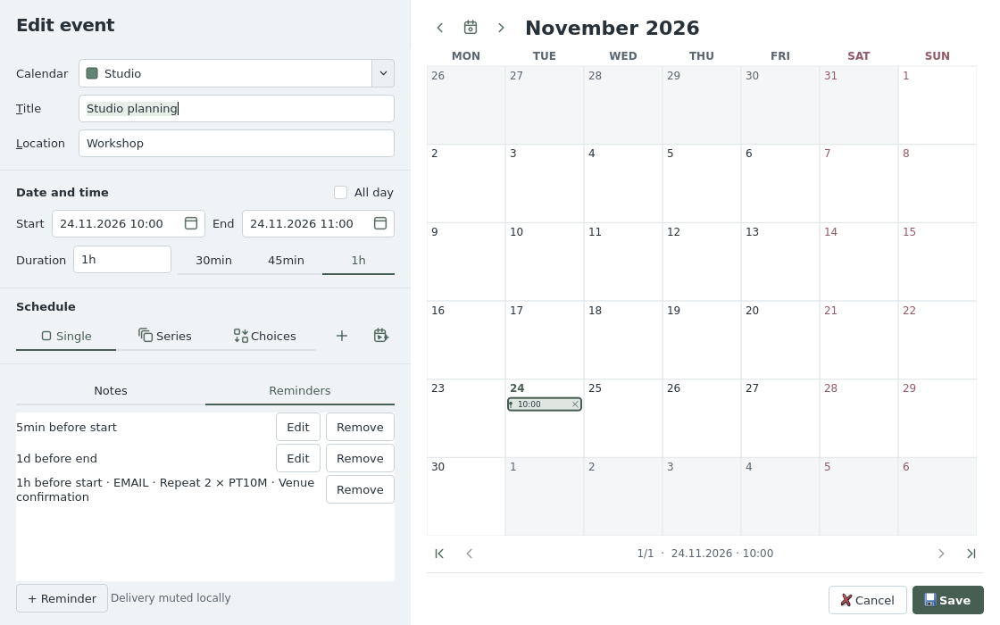
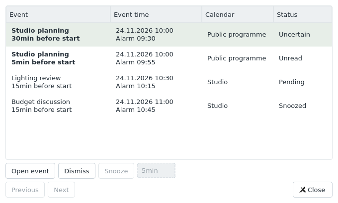

# Event reminders

In the event editor, switch from **Notes** to **Reminders** and choose **+ Reminder**. Choose an offset before or after the start or end, or choose **Date and time** for a fixed instant. A day follows the event’s local calendar across daylight-saving changes. An offset of 24 hours measures elapsed time.

Relative alarms on a series apply to its occurrences. A fixed alarm on the master fires once for that series. A detached occurrence can have its own alarms. The editor shows the active scope and flags selections with different reminder lists. Under **This and following**, the original series keeps its series-wide fixed alarm when it splits. You can edit it under **All in series**.

## Delivery

Event notifications start switched off. Open **Preferences → Notifications**, enable delivery, and choose **Desktop**, **In the app**, or **Both**. The desktop service controls how native alerts appear. Debacal supports local display and audio reminders and can ask the desktop to stay silent. Imported email alarms, procedures and unsupported alarm data stay with the event. Debacal never sends reminder email, runs an attached program, or downloads an alarm sound.

The app must be running. On a desktop with a tray, choose **Keep running in the tray** to hide the window while reminders and synchronization continue. Use **Show Debacal** to restore the window or **Quit Debacal** to stop. Without a tray host, closing quits. If a tray host disappears while the window is hidden, Debacal restores the window.

Use **Reminders** in the sidebar footer to open the inbox. **Open** goes to the event, **Dismiss** closes that occurrence’s selected alarm and its remaining repeats, and **Snooze** offers five minutes or a duration you enter. An uncertain entry records a handoff that ended before desktop delivery could be confirmed. One running instance owns delivery for a profile. Snoozes, receipts and dismissals are local to that profile.

On first enable and after deliberate muting, delivery begins with future triggers. After an interruption, the default missed-reminder policy considers the past 24 hours for upcoming or ongoing events. You can include all recent reminders or skip missed reminders. Missed repeats of the same alarm and occurrence are grouped. Editing a delivered alarm can make a new future trigger eligible. For ambiguous edits to several imported alarms without UIDs, a prior disposition on the same occurrence and repeat can suppress a past trigger.

## Calendar and import choices

Under **Calendar sources**, a calendar can use its saved event reminders, mute delivery or use a local relative reminder list. These policies also work on read-only calendars. Turning off a source stops delivery. Hiding it with the eye or folding its group only changes its presentation.

New timed and all-day events each start with no saved reminders. Set their defaults independently in **Notifications**. Manual imports initially keep saved reminders. The import review also offers **Remove**, **Add when missing**, and **Replace** for the selected resources. Saving an event reminder or importing with one of these choices changes the calendar data and supports undo and redo.

An iCalendar rule with an independently zoned end during a repeated clock hour can have a nominal end-relative trigger whose exact instant varies by occurrence. Debacal reports the affected resource if it cannot encode that schedule portably. The canonical event and its local reminder remain available. [Calendar synchronization](SYNC.md) · [Performance measurements](../design/notification-performance.md)
